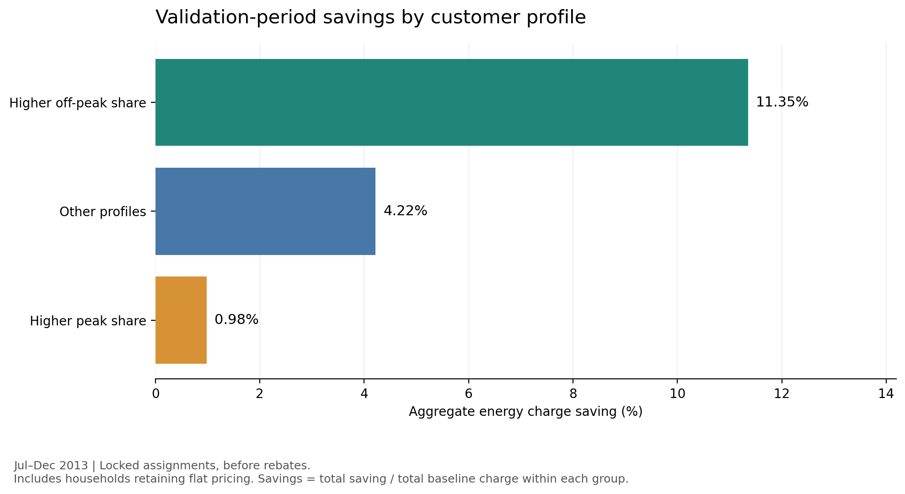
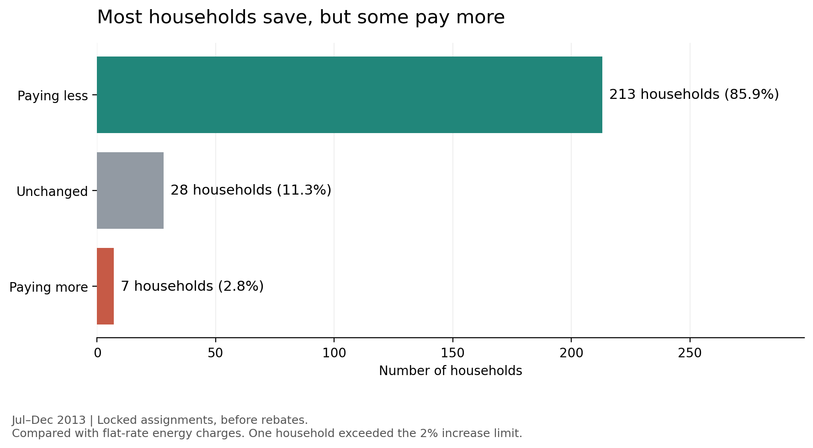
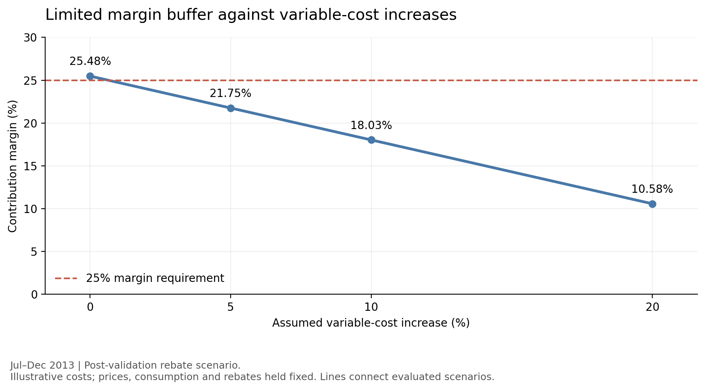

# Electricity Customer Insights & Tariff Optimisation

A retail electricity analytics portfolio project using Python, SQL, Power BI,
optimisation and an LLM explanation pilot to examine which customers may benefit from time-of-use
pricing, while balancing customer bill protection and supplier contribution.

The analysis uses historical UK household consumption. Tariffs and variable
costs are illustrative scenarios, not current commercial offers.

## Key findings

- A single tariff for all 248 households could not meet both a 25%
  portfolio contribution margin and a maximum 2% household energy charge
  increase within the specified price bounds.
- A selective-switching scenario assigned 220 households to time-of-use
  pricing and retained 28 on flat pricing.
- With prices and assignments locked using January–June data, July–December
  evaluation produced GBP 3,925.50 in aggregate simulated savings.
- 213 households paid less, 28 were unchanged and seven paid more.
  One household exceeded the 2% increase limit.
- A post-validation rebate scenario required GBP 3.79 to cap half-year
  increases at 2%, while retaining a 25.48% contribution margin.
- Cost headroom was limited: approximately a 0.65% increase in assumed
  variable costs would reduce the protected scenario's margin below 25%.

These results support further investigation of selective switching.
They do not establish that the tariff is ready for commercial rollout.

- Monthly monitoring revealed exposure hidden by half-year totals: 55 households
  paid more in at least one month, including 48 that still saved over H2.
  Ten households paid more for at least three consecutive months.
- An independent Python runner reproduced the H2 results and completed six
  monthly runs with locked prices, assignments and the saved profile model.

## Dashboard

The three-page Power BI report covers:

| Page | Decision supported |
| --- | --- |
| Customer Profiles | Compare design-period usage segments, weekday/weekend profiles and exploratory clusters |
| Tariff Impact | Compare simulated savings, supplier contribution and household charge outcomes before rebates |
| Risk & Monitoring | Inspect monthly charge increases, persistent exposure and a separate cost-stress scenario |

- [Dashboard PDF](reports/electricity_tariff_dashboard.pdf) — static preview.
- [Power BI report](reports/electricity_tariff_dashboard.pbix) — interactive report; requires Power BI Desktop.

Dashboard source tables are exported to `data/dashboard/`. The model uses
`Customers` as the unique household table, with single-direction one-to-many
relationships to `DesignProfiles` and `MonthlyMonitoring`. `CostStress` is a
separate fixed-portfolio scenario table and does not respond to household filters.
Three-page filter and chart-interaction checks were completed manually.
The PDF shows visible table rows; the interactive report supports scrolling.

## Business questions

1. How do household consumption profiles differ?
2. Which profiles benefit from the candidate time-of-use tariff?
3. Can customer savings coexist with supplier contribution requirements?
4. Do prices and customer assignments remain suitable in a later period?
5. How sensitive are results to costs and unusual consumption records?

The intended audience is an electricity retailer's customer insights,
pricing or product team.

## Data and sample preparation

Source: [Low Carbon London smart-meter data](https://data.london.gov.uk/dataset/smartmeter-energy-consumption-data-in-london-households-vqm0d).

The workflow inspected 168 source CSV files and identified 4,411
standard-tariff households with records in the analysis year.

A preliminary pool contained 3,594 households meeting date-coverage and
raw-row-count filters. From this pool, 1,000 households were sampled using
random seed 42.

Detailed checks retained 248 households with complete, valid and
non-conflicting half-hour readings for 2013:

- 4,344,960 unique household intervals.
- 1,038,488.042 kWh of recorded consumption.
- Duplicate keys with identical readings were collapsed.
- Missing readings were not imputed.
- Zero readings were retained.

Four households were flagged for unusual annual or monthly zero-reading
patterns. They remained in the primary sample, with a separate exclusion
sensitivity check.

Flags indicate records requiring review, not confirmed errors.
Complete-case selection limits representativeness.

## Time handling

Consumption timestamps represent UTC interval ends. The analysis derives
interval starts by subtracting 30 minutes.

Pricing bands use interval starts converted to Europe/London local time,
including daylight-saving changes.

| Band | Definition |
| --- | --- |
| Peak | Monday–Friday, 16:00–20:00 |
| Off-peak | Every day, 00:00–07:00 |
| Shoulder | All remaining intervals |

Band start times are inclusive and end times are exclusive.
Bank holidays are treated as ordinary weekdays.

The design and validation periods are split using UTC interval starts:

- Design: 1 January–30 June 2013.
- Validation: 1 July–31 December 2013.

## Customer insights

Households were grouped using design-period consumption shares:

- Higher off-peak share.
- Higher peak share.
- Other profiles.

Thresholds use the design sample's 75th percentiles. Higher off-peak
share takes priority when both thresholds are met.

These are descriptive rule-based segments, not machine-learning clusters
or evidence of customers' willingness to change consumption.



Under locked assignments before rebates, aggregate validation-period
savings were 11.35% for the higher off-peak group, 0.98% for the higher
peak group and 4.22% for other profiles.

These group results include customers who retained flat pricing.

### Exploratory profile clustering

A separate K-means analysis used normalised H1 mean half-hour profiles:
48 weekday and 48 weekend features per household. Each household's combined
96-feature profile was scaled to a mean of one, allowing comparison of shape.
This is distinct from the rule-based usage segments above.

The two-cluster solution identified 8 households with night-concentrated
profiles and 240 with other consumption profiles. Its silhouette score was
approximately 0.64; this is a clustering separation measure, not accuracy.
The larger group remains diverse, and the labels do not identify appliances.

The saved H1 model was applied to H2 without retraining: 246 of 248 households
retained their group, while two moved from the night-concentrated group to
other profiles. Group agreement does not establish unchanged behaviour or
future tariff suitability. Clusters did not determine tariff assignments.

## Tariff optimisation

### Assumptions

All rates are GBP/kWh.

| Band | Assumed variable cost | Candidate price range |
| --- | ---: | ---: |
| Peak | 0.15 | 0.18–0.24 |
| Shoulder | 0.10 | 0.12–0.15 |
| Off-peak | 0.06 | 0.06–0.10 |

The flat-rate baseline is GBP 0.14228/kWh.

Contribution is energy revenue minus assumed variable costs.
Contribution margin is contribution divided by energy revenue.
It is not net profit.

Consumption is held unchanged across tariffs. Standing charges, fixed
costs and implementation costs are excluded.

### All-household switching

The initial grid evaluated 48 price combinations, requiring:

- Portfolio contribution margin of at least 25%.
- No household energy charge increase above 2%.

No grid combination was feasible. Linear programming also found no
feasible continuous solution within the same price bounds.

With the household increase limit retained, the maximum achievable
contribution margin was approximately 24.03%.

### Selective switching

A separate scenario assigned households to time-of-use pricing only when
their design-period charges were lower than under flat pricing.
Other households retained flat pricing.

Among the 48 grid combinations, 28 met the portfolio margin requirement.
The combination with the largest total design-period savings was:

| Band | Selected rate |
| --- | ---: |
| Peak | 0.22 |
| Shoulder | 0.13 |
| Off-peak | 0.08 |

This assigned 220 households to time-of-use pricing and 28 to flat pricing.
Prices and assignments were locked before validation.

Assignments simulate switching; they do not measure actual customer uptake.
The chosen rates are optimal only among the tested grid combinations
under the stated scenario.

## Validation results



| Metric | July–December result before rebates |
| --- | ---: |
| Flat-rate baseline energy charges | GBP 69,616.05 |
| Assigned-tariff energy charges | GBP 65,690.55 |
| Aggregate customer saving | GBP 3,925.50 |
| Households paying less | 213 |
| Households unchanged | 28 |
| Households paying more | 7 |
| Households exceeding a 2% increase | 1 |
| Maximum household increase | 2.77% |
| Portfolio contribution margin | 25.49% |

The margin requirement passed, but the household increase requirement
failed. Prices and assignments were not changed to improve these results.

### Post-validation bill protection

After inspecting validation results, an illustrative half-year rebate
scenario capped charges at 102% of the flat-rate benchmark.

A total rebate of GBP 3.79 increased aggregate savings to GBP 3,929.28
and retained a contribution margin of 25.48%.

This was a post-validation mitigation, not an independently tested strategy.
It limits half-year increases to 2%; it does not guarantee savings or cap
individual monthly bills.

## Sensitivity analysis



The protected scenario's contribution margin fell from 25.48% to 21.75%
when assumed variable costs increased by 5%.

Excluding the four flagged households changed aggregate protected savings
from 5.64% to 5.53%, and contribution margin from 25.48% to 25.49%.
Prices and assignments remained unchanged.

This exclusion check is retrospective because flags use full-year data.

## Historical monthly monitoring

The independent pipeline evaluated six UTC calendar months from July through
December using the same locked prices, assignments and H1 profile model.
All figures below are before rebates.

| Month | Customer saving (GBP) | Households paying more | Above 2% review threshold | Review required |
| --- | ---: | ---: | ---: | ---: |
| Jul 2013 | 618.84 | 4 | 1 | 6 |
| Aug 2013 | 659.47 | 3 | 1 | 4 |
| Sep 2013 | 626.98 | 4 | 1 | 6 |
| Oct 2013 | 580.80 | 23 | 6 | 26 |
| Nov 2013 | 664.11 | 35 | 9 | 36 |
| Dec 2013 | 775.29 | 33 | 7 | 35 |

Review reasons include paying more, exceeding the threshold, a profile-group
change relative to H1, or an unavailable profile. Reasons can overlap.
Across H2, 55 households had at least one higher-charge month, 48 of those
still saved over the half-year, and 10 had at least three consecutive
higher-charge months. These counts describe different exposure measures;
monthly percentages and group labels are not additive.

A zero-consumption month is retained for billing and monitoring, but its
profile cannot be normalised. The pipeline records an unavailable profile,
leaves the cluster and profile-change comparison missing, and flags review.
Zero readings alone do not establish their cause.

The 1,488 household-month rows reconciled to H2 household totals for energy,
baseline charges, time-of-use charges, assigned charges, savings and variable
costs within floating-point tolerance. Assignments remained fixed.
Outputs are saved in [reports/monthly_monitoring](reports/monthly_monitoring/).

Monitoring is a retrospective historical demonstration, not a live deployment.
The monthly 2% threshold prompts review; it is not a bill guarantee, does not
apply a monthly rebate, and does not automatically reassign customers.
Scheduling has not been configured.

## AI-assisted explanation pilot

A small OpenAI API pilot generated explanations from structured facts drawn
from the saved H2 review queue. Three cases covered a small charge increase,
an increase above the 2% threshold, and a profile change despite lower charges.
The model used was `gpt-4o-mini` (returned snapshot `gpt-4o-mini-2024-07-18`).

The workflow used a structured output schema, an allowed evidence-path list
and checks for coverage of each case's review triggers. Five API responses
were retained across initial and revised requests. Three edited drafts,
source facts, correction logs, response metadata and a human-review queue
were saved under [reports/ai_explanations](reports/ai_explanations/).

The pilot exposed limitations: an initial response used incomplete evidence
paths; other drafts omitted review triggers or inferred unchanged consumption
from an unchanged cluster label. References were corrected, instructions were
revised, and unsupported wording was edited while preserving raw responses.

Structure and evidence coverage checks do not prove factual meaning or numeric
correctness. All three edited explanations remain **pending human review**.
This is a three-case explanation pilot, not an autonomous customer advisory
system or a batch AI stage in the standalone pipeline. API keys are configured
locally and must not be committed to the repository.

## Calculation validation

Completed checks include:

- Independent Decimal-based recalculation of seven monetary fields for
  all 248 households, using saved band totals and configuration.
- Thirteen predefined time-band boundary scenarios covering weekdays,
  weekends, seasonal offsets and clock changes.
- DuckDB time-band aggregation reconciled against both design and
  validation CSV exports across 4,344,960 prepared intervals.
- Customer-segment totals reconciled with portfolio totals.

Additional pipeline checks covered valid inputs, reversed or misaligned
periods, missing and duplicate intervals, negative or missing energy, and
unexpected households. Manual cases checked time-of-use bills, retained flat
assignments, variable costs and values below, exactly at and above the 2%
review threshold. Zero-consumption handling and July export checks also passed.
An independent Python process reproduced H2 outputs, and exported bills,
monitoring, review queues and run summaries were reconciled.

Validation records are saved in
[reports/validation](reports/validation/).

These checks establish agreement within stated tolerances.
They do not independently validate source ingestion, supplier costs
or customer behaviour.

## Tools and notebooks

Python, pandas, NumPy, DuckDB SQL, SciPy linear programming, scikit-learn,
joblib, Matplotlib, Jupyter Notebook, OpenAI API and Power BI.

| Notebook | Purpose |
| --- | --- |
| [01 — Data inspection](notebooks/01_electricity_data_inspection.ipynb) | Inspect data, investigate duplicates and develop the six-household pilot |
| [02 — Sample preparation](notebooks/02_customer_sample_preparation.ipynb) | Build the DuckDB sample, assess completeness and record quality flags |
| [03 — Customer insights](notebooks/03_customer_insights.ipynb) | Create design-period features and descriptive segments |
| [04 — Tariff optimisation](notebooks/04_tariff_optimisation.ipynb) | Evaluate constraints, lock assignments and analyse validation outcomes |
| [05 — Visualisation](notebooks/05_results_visualisation.ipynb) | Create presentation charts from saved results |
| [06 — Calculation validation](notebooks/06_calculation_validation.ipynb) | Reconcile billing calculations and time-band exports |

Later notebooks in `notebooks/` extend the workflow:

| Stage | Purpose |
| --- | --- |
| 07 — Profile modelling | Build normalised profiles, explore K-means groups and evaluate fixed-model cross-period agreement |
| 08 — Pipeline and monitoring | Extract reusable functions, validate independent runs and reconcile six monthly evaluations |
| 09 — AI explanations | Prepare evidence packs, run a three-case API pilot and export drafts for human review |
| 10 — Dashboard preparation | Reconcile and export four Power BI source tables |

Reusable code is in `src/consumption_pipeline.py`; the command-line entry point
is `src/run_pipeline.py`. Saved model files are in `models/`.

The six-household pilot is exploratory development work.
Headline findings use the 248-household sample.

## Running the project

The demonstrated environment used Python 3.9.15.

Install the recorded analysis dependencies:

    python -m pip install -r requirements.txt

Jupyter Notebook must also be installed in the environment.

### Run the prepared-data pipeline

From the project root, after creating the database, locked tariff artifacts
and saved profile model through the analysis notebooks:

```bash
python src/run_pipeline.py --start 2013-07-01 --end 2014-01-01
```

For a monthly evaluation:

```bash
python src/run_pipeline.py --start 2013-07-01 --end 2013-08-01
```

Start is inclusive and end is exclusive, using UTC interval starts. The runner
requires the prepared DuckDB database, locked configuration and assignments,
H1 design groups, and trusted model/metadata files. It does not ingest the raw
source files, optimise a new tariff, retrain the model, apply rebates or call
the OpenAI API.

Each successful run writes a timestamped folder under `reports/pipeline_runs/`
containing band totals, customer bills, normalised profiles, monitoring,
a review queue, a run summary and a tariff-configuration snapshot.
See [pipeline usage](reports/pipeline_usage.md) for additional usage notes;
the zero-consumption behaviour is described above.

### Rebuild from raw inputs

For full reproduction:

1. Obtain and extract the original consumption CSV files into data/raw/.
   Notebook 01 also inspects Tariffs.xlsx.
2. Update project_folder in each notebook to your local project root.
3. Review the notebooks and run them in order, using separate kernels.
4. Close database connections before opening the next notebook.
5. Retain intermediate CSV files and the DuckDB database required by
   later notebooks.

Notebook 01 inspects the supplied dynamic tariff workbook. The main
optimisation instead uses the custom static pricing bands documented above.

Raw inputs and the generated DuckDB database are obtained or created
locally. Viewing the saved figures does not require them.

The standalone runner has been executed in an independent Python process,
including H2 and all six monthly evaluations. This verifies execution from
prepared artifacts. A clean raw-input-to-dashboard rerun and fresh-environment
installation have not yet been verified. AI explanations are an optional,
separate notebook workflow and require local API credentials and API usage.

## Limitations and next steps

- Historical UK households do not establish current New Zealand demand
  or tariff suitability.
- Full-year completeness informed sample selection; evaluation is not
  a fully untouched prospective holdout.
- Pilot analysis had already inspected a small subset of households.
- Candidate prices and supplier variable costs are illustrative.
- Consumption responses, customer uptake and switching costs are unmodelled.
- Savings are simulated energy-charge differences, not realised benefits.
- One later half-year cannot establish long-term reliability; monthly runs
  partition the same H2 data and are not six independent holdout datasets.
- Exploratory profile groups do not establish appliance ownership or causes
  of consumption changes.
- LLM explanations require human content review; schema compliance is not
  factual validation.

Further work should validate cost assumptions, evaluate additional periods,
complete a clean reproducibility run and assess practical customer-protection
arrangements. Before reuse, rerun the function checks against the final
monthly-handling code and confirm exported dashboard files are included.

## Author

Jiali Yang